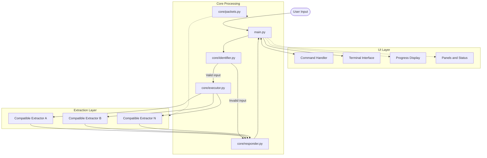

<div align="center">

<pre>
                                                  
                                                  
           ███                      ███           
         ████████                ████████         
        ██████████   ██    ██  ███████████        
       ███     ████████    ████████     ███       
       █▒█        ████      ████        █▒█       
       █▓█     ███ █          █ ███     █▓█       
       ███        █            █        ███       
       ███         ██        ██         ███       
        ███         ██      ██         ███        
           ██       ██      ██       ██           
                    ███    ███                    
                      █    █                      
                      █    █                      
                                                  
                       █  █                       
                                                  
                                                  
</pre>

</div>

<div align="center">


</div>

# Theseus

**Digital Artefact Extraction Tool**

Theseus is a modular command-line tool for identifying and extracting structured information from digital artefacts.

It accepts artefacts as input, validates their type, and dispatches them to specialised extractors. A single input may be processed by multiple compatible extractors, each returning its results through a standardised Packet structure.

Extracted information retains its source context, provenance, and explicitly identified entities or related entities.

The artefact is the starting point. The entities it reveals are the leads.

## Features

- **Artefact identification**: Validates supplied input against supported artefact types.
- **Modular extraction**: Dispatches inputs to specialised extractors according to their type.
- **Multi-extractor processing**: Allows multiple compatible extractors to process the same input.
- **Structured output**: Returns extraction results through a consistent Packet format.
- **Entity extraction**: Records entities explicitly identified within source artefacts.
- **Provenance tracking**: Preserves the origin and context of extracted information.
- **Error handling**: Records extraction failures and supports partial results when individual extractors encounter errors.
- **Extensible architecture**: Keeps extraction logic independent from the core processing pipeline.
- **Terminal interface**: Provides an interactive command-line environment with formatted output and processing status.

## Architecture

Theseus follows a sequential processing architecture. Each component has a defined responsibility and communicates through a shared Packet structure.



## Packet Structure

All processing stages communicate through a standardised Packet envelope.

The Packet provides a consistent structure for requests, extraction results, and errors, regardless of the artefact being processed.

| Field | Description |
|---|---|
| `request_id` | Identifies the original request. |
| `task_id` | Identifies the current processing task. |
| `parent_task_id` | Identifies the parent task, where applicable. |
| `stage` | Indicates the current processing stage. |
| `artefact_type` | Identifies the artefact being processed. |
| `input` | Contains the supplied input. |
| `source` | Records the source of the artefact. |
| `status` | Represents the processing state. |
| `data` | Stores extracted information. |
| `entities` | Stores entities explicitly identified in the artefact. |
| `related_entities` | Stores explicitly identified related information. |
| `provenance` | Records the origin and context of extracted data. |
| `errors` | Records errors and warnings encountered during processing. |
| `metadata` | Stores supplementary processing information. |

### Packet statuses

| Status | Description |
|---|---|
| `PENDING` | Processing has not yet started. |
| `RUNNING` | Processing is currently underway. |
| `SUCCESS` | Extraction completed successfully. |
| `PARTIAL_SUCCESS` | Extraction completed with some errors or incomplete results. |
| `FAILED` | Extraction failed. |
| `NOT_SUPPORTED` | The input or operation is not supported. |
| `NOT_IMPLEMENTED` | No corresponding extractor is currently implemented. |

Each extractor returns its own Packet. This allows multiple extraction results to be collected independently while maintaining a consistent response structure.

## Supported Inputs and Flags

Theseus accepts input through command flags. Each flag represents an accepted input type rather than an individual extraction operation.

The identifier validates the input, after which the executor dispatches it to the compatible extractor or extractors.

### Network and Infrastructure

| Flag | Accepted input |
|---|---|
| `--url` | URL |
| `--domain` | Domain name |
| `--hostname` | Hostname |
| `--ip` | IPv4 or IPv6 address |
| `--cidr` | CIDR network range |
| `--port` | Port number |
| `--mac-address` | MAC address |
| `--asn` | Autonomous System Number |
| `--tls-host` | Hostname or HTTPS URL for TLS inspection |
| `--certificate` | X.509 certificate |
| `--http-message` | Structured HTTP message |
| `--network-capture` | PCAP or PCAPNG file |

### Web and Browser

| Flag | Accepted input |
|---|---|
| `--html-document` | HTML source |
| `--javascript-source` | JavaScript source |
| `--css-source` | CSS source |
| `--http-archive` | HAR file or HAR JSON source |
| `--browser-profile` | Supported Chromium or Firefox browser profile |

### Files and Documents

| Flag | Accepted input |
|---|---|
| `--file` | File path |
| `--directory` | Directory path |
| `--hash` | Hash digest |
| `--binary-file` | Binary file |
| `--pdf` | PDF file |
| `--office-document` | DOCX, XLSX, or PPTX file |
| `--archive` | Supported compressed archive |
| `--font` | TTF, OTF, TTC, WOFF, or WOFF2 file |
| `--shortcut` | LNK, URL shortcut, or desktop entry file |

### Media

| Flag | Accepted input |
|---|---|
| `--image` | Supported image file |
| `--audio` | Supported audio file |
| `--video` | Supported video file |

### Email and Communications

| Flag | Accepted input |
|---|---|
| `--email` | Raw email source, EML file, or MBOX file |
| `--contact` | Email address, phone number, or vCard source |
| `--calendar` | iCalendar source or ICS file |

### Software and Development

| Flag | Accepted input |
|---|---|
| `--git-repository` | Local Git repository |
| `--git-commit` | Commit hash or repository path with commit hash |
| `--package-manifest` | Supported package manifest or lockfile |
| `--sbom-document` | Supported CycloneDX or SPDX document |
| `--container-artefact` | Supported container configuration or artefact |

### Structured Data

| Flag | Accepted input |
|---|---|
| `--json-document` | JSON source or file |
| `--xml-document` | XML source or file |
| `--csv-document` | CSV source or file |
| `--sqlite-database` | SQLite database file |

### System Artefacts

| Flag | Accepted input |
|---|---|
| `--config-file` | INI, TOML, YAML, or JSON configuration |
| `--environment-file` | Environment variable source or `.env` file |
| `--registry-artefact` | Windows Registry hive or REG export |
| `--log` | Supported log source or file |

## Extractor Scope

The supported extractors cover a range of digital artefacts, including:

| Category | Extraction capabilities |
|---|---|
| Web and Browser | URL components, redirects, HTTP messages, HTML structure, JavaScript, CSS, HAR data, browser history, bookmarks, cookies, and autofill metadata. |
| Network and Infrastructure | IP addresses, CIDR ranges, hostnames, domains, DNS records, ASNs, MAC addresses, BSSIDs, ports, TLS information, certificates, PCAP metadata, and network flows. |
| Files and Documents | File metadata, hashes, binary characteristics, PDF contents and metadata, office document contents, archives, fonts, shortcuts, and directory contents. |
| Media | Image metadata and EXIF information, audio metadata and tags, video streams, codecs, and container metadata. |
| Email and Communications | Email messages, headers, Message-IDs, contacts, vCards, calendars, and scheduling components. |
| Software and Development | Git repositories, commits, package manifests, SBOM documents, and container artefacts. |
| Structured Data | JSON, XML, CSV, SQLite databases, and configuration formats. |
| Operating Systems | Environment variables, Windows Registry artefacts, logs, and browser profile data. |

Extraction is limited to information available within the supplied artefact or through the specific extractor's documented retrieval behaviour. Theseus does not infer relationships or perform investigative analysis on extracted entities.

## Example

A URL can be submitted through the interactive terminal:

```text
theseus > --url https://github.com
```

A simplified example of the resulting extraction output:

```text
Artefact    url
Status      SUCCESS

Results
  Url               https://github.com
  Scheme            https
  Hostname          github.com
  Domain            github.com
  Port              None
  Path              None
  Query Parameters  None
  Fragment          None
```

An input may produce multiple extraction results when more than one extractor is compatible with its artefact type.

For example, a URL may be processed by both the URL extractor and redirect extractor.

Output fields vary according to the artefact type and the information available in the source.

## Installation

Theseus requires Python 3.11 or later.

Clone the repository:

```bash
git clone <repository-url>
cd theseus
```

Install the Python dependencies:

```bash
pip install -r requirements.txt
```

Alternatively, install the project and its declared dependencies:

```bash
pip install .
```

Some extractors rely on external software. In particular, the video extractor requires FFmpeg's `ffprobe` executable to be available on the system PATH.

## Usage

Start Theseus:

```bash
python main.py
```

Enter a supported flag followed by its corresponding input:

```text
theseus > --ip 8.8.8.8
theseus > --domain example.com
theseus > --url https://example.com
```

The terminal interface displays extraction status and the results returned by the compatible extractors.

## Dependencies

Theseus uses Python libraries for parsing, metadata extraction, file processing, network operations, and terminal presentation.

External dependencies may be required for particular extraction capabilities. See `requirements.txt` for the Python dependency list.

## Limitations

- Extraction depends on the structure, format, and completeness of the supplied artefact.
- Unsupported or malformed inputs may return validation errors or failed extraction Packets.
- Some extraction capabilities require external software or network access.
- Browser, email, environment, and other system artefacts may contain sensitive information.
- Theseus extracts information present in its source artefacts. It does not independently establish the accuracy, ownership, or significance of that information.

## Contributing

Contributions, bug reports, and suggestions are welcome. When reporting a problem, include the operating system, Python version, installation method, relevant command output, and steps needed to reproduce it. Never include private credentials or sensitive investigation data.

## Documentation

- **[Wiki](https://github.com/Proxy-Phaethon/theseus/wiki):** Detailed project documentation, technical references, and investigation-specific information.
- **[Releases](https://github.com/Proxy-Phaethon/theseus/releases):** Version history, release notes, and changes between releases.

## License

Theseus is released under the Apache License 2.0. See [LICENSE](LICENSE) for details.

<div align="center"> <pre>
░▒▓████████▓▒░▒▓█▓▒░░▒▓█▓▒░▒▓████████▓▒░░▒▓███████▓▒░▒▓████████▓▒░▒▓█▓▒░░▒▓█▓▒░░▒▓███████▓▒░ 
   ░▒▓█▓▒░   ░▒▓█▓▒░░▒▓█▓▒░▒▓█▓▒░      ░▒▓█▓▒░      ░▒▓█▓▒░      ░▒▓█▓▒░░▒▓█▓▒░▒▓█▓▒░        
   ░▒▓█▓▒░   ░▒▓█▓▒░░▒▓█▓▒░▒▓█▓▒░      ░▒▓█▓▒░      ░▒▓█▓▒░      ░▒▓█▓▒░░▒▓█▓▒░▒▓█▓▒░        
   ░▒▓█▓▒░   ░▒▓████████▓▒░▒▓██████▓▒░  ░▒▓██████▓▒░░▒▓██████▓▒░ ░▒▓█▓▒░░▒▓█▓▒░░▒▓██████▓▒░  
   ░▒▓█▓▒░   ░▒▓█▓▒░░▒▓█▓▒░▒▓█▓▒░             ░▒▓█▓▒░▒▓█▓▒░      ░▒▓█▓▒░░▒▓█▓▒░      ░▒▓█▓▒░ 
   ░▒▓█▓▒░   ░▒▓█▓▒░░▒▓█▓▒░▒▓█▓▒░             ░▒▓█▓▒░▒▓█▓▒░      ░▒▓█▓▒░░▒▓█▓▒░      ░▒▓█▓▒░ 
   ░▒▓█▓▒░   ░▒▓█▓▒░░▒▓█▓▒░▒▓████████▓▒░▒▓███████▓▒░░▒▓████████▓▒░░▒▓██████▓▒░░▒▓███████▓▒░  
</pre>