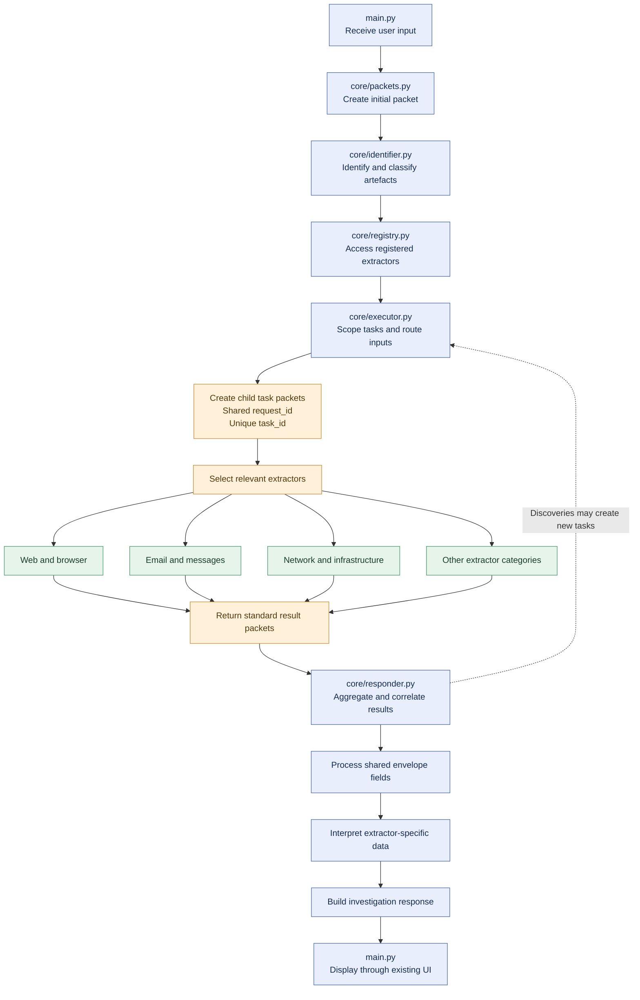

<pre>
                                                  
                                                  
           ███                      ███           
         ████████                ████████         
        ██████████   ██    ██  ███████████        
       ███     ████████    ████████     ███       
       █▒█        ████      ████        █▒█       
       █▓█     ███ █          █ ███     █▓█       
       ███        █            █        ███       
       ███         ██        ██         ███       
        ███         ██      ██         ███        
           ██       ██      ██       ██           
                    ███    ███                    
                      █    █                      
                      █    █                      
                                                  
                       █  █                       
                                                  
                                                  
</pre>

# Theseus

**A digital artefact extraction and intelligence platform.**

Theseus discovers, extracts, classifies, and correlates entities hidden within digital artefacts. It transforms raw digital information into structured, traceable intelligence that can be investigated further.

From email headers and browser metadata to document properties, network traffic, operating-system artefacts, and online infrastructure, Theseus provides a unified framework for extracting meaningful information from the digital world.

## Overview

Digital artefacts contain more information than their visible contents suggest. An email can expose its routing infrastructure. A document can reveal its author and creation history. A website can disclose related domains, account identifiers, external services, and embedded resources. A system log can connect accounts, devices, processes, and network activity.

Theseus is designed to extract these details systematically, identify the entities they reveal, and establish relationships between them.

Rather than requiring an investigator to begin with a known email address, domain, IP address, or username, Theseus can begin with the artefact itself.

**The artefact is the starting point. The entities it reveals are the leads.**

## Core Capabilities

### Artefact Extraction

Theseus processes digital artefacts across multiple formats and environments, extracting structured information from their contents and metadata.

Supported artefact categories include:

- **Web and browser:** HTTP headers, HTML, cookies, browser history, local storage, redirects, web archives, and application metadata.
- **Email and communications:** Email headers, MIME messages, attachments, SMS/MMS exports, chat records, contact cards, and call metadata.
- **Internet infrastructure:** DNS records, TLS certificates, Certificate Transparency entries, WHOIS/RDAP data, IP allocation records, routing information, and service banners.
- **Files and documents:** PDF and Office documents, images, audio, video, archives, file metadata, hashes, digital signatures, and embedded resources.
- **Operating systems:** Windows Registry and event logs, macOS system artefacts, Linux logs, filesystem metadata, execution traces, and device records.
- **Network traffic:** PCAP/PCAPNG captures, HTTP exchanges, DNS traffic, TLS handshakes, flow records, firewall logs, and network configuration.
- **Identity and authentication:** Account identifiers, usernames, credential records, cookies, API keys, tokens, certificates, and exposed secrets.
- **Social platforms:** Public profiles, posts, comments, account identifiers, linked accounts, and publicly accessible platform data.
- **Mobile devices:** Application databases, device backups, messages, contacts, call records, media metadata, and application configuration.
- **Software and repositories:** Git history, package manifests, dependency lockfiles, source code, build logs, API specifications, and infrastructure configuration.
- **Databases and structured data:** JSON, XML, YAML, CSV, SQL dumps, SQLite databases, spreadsheets, and API response archives.
- **Cloud and enterprise systems:** Audit logs, resource inventories, identity-provider records, SaaS activity, cloud configurations, and object-storage metadata.
- **Corporate and public records:** Company filings, annual reports, securities disclosures, patents, procurement records, public datasets, and organisational documents.
- **Geospatial and multimedia:** EXIF GPS data, GPX tracks, KML/KMZ, GeoJSON, OCR text, transcripts, and media fingerprints.

## Architecture

The architecture separates five principal responsibilities:

1. **Identification:** Determine what kind of artefact or input has been supplied.
2. **Registration:** Make available the extractors capable of processing relevant inputs.
3. **Execution:** Create, scope, and route extraction tasks.
4. **Interpretation:** Normalise and correlate the results returned by extractors.
5. **Presentation:** Deliver the resulting investigation response through the existing interface.

The registry and executor provide the foundation for extending the platform with additional extractors without restructuring the entire investigation workflow.

## Investigation Workflow

A typical investigation follows this sequence:

1. An investigator supplies an artefact or supported input through the main interface.
2. Theseus creates an initial packet representing the request.
3. The identifier classifies the input and determines the relevant artefact or entity types.
4. The registry provides access to suitable extractors.
5. The executor creates and routes individual extraction tasks.
6. Extractors process their assigned inputs and return structured results.
7. The responder aggregates the results, interprets extractor-specific data, and identifies relationships between findings.
8. Newly discovered entities can trigger additional extraction tasks.
9. Theseus assembles the findings into an investigation response for presentation.

Each task remains associated with its originating request, providing a basis for tracing findings back to the extraction operations that produced them.

## Version

**Target release: v1.0.0**

Theseus v1.0.0 establishes the artefact extractor as the foundation of the platform, with entity investigation and relationship discovery built around the information it uncovers.

The release centres on a unified packet contract, modular extractor registration, controlled task execution, structured result aggregation, and an architecture designed to support increasingly complex investigations.

---
## Contributing

Contributions, bug reports, and suggestions are welcome. When reporting a problem, include the operating system, Python version, installation method, relevant command output, and steps needed to reproduce it. Never include private credentials or sensitive investigation data.

## Documentation

- **[Wiki](https://github.com/Proxy-Phaethon/theseus/wiki):** Detailed project documentation, technical references, and investigation-specific information.
- **[Releases](https://github.com/Proxy-Phaethon/theseus/releases):** Version history, release notes, and changes between releases.

## License

Theseus is released under the Apache License 2.0. See [LICENSE](LICENSE) for details.

 <pre>
░▒▓████████▓▒░▒▓█▓▒░░▒▓█▓▒░▒▓████████▓▒░░▒▓███████▓▒░▒▓████████▓▒░▒▓█▓▒░░▒▓█▓▒░░▒▓███████▓▒░ 
   ░▒▓█▓▒░   ░▒▓█▓▒░░▒▓█▓▒░▒▓█▓▒░      ░▒▓█▓▒░      ░▒▓█▓▒░      ░▒▓█▓▒░░▒▓█▓▒░▒▓█▓▒░        
   ░▒▓█▓▒░   ░▒▓█▓▒░░▒▓█▓▒░▒▓█▓▒░      ░▒▓█▓▒░      ░▒▓█▓▒░      ░▒▓█▓▒░░▒▓█▓▒░▒▓█▓▒░        
   ░▒▓█▓▒░   ░▒▓████████▓▒░▒▓██████▓▒░  ░▒▓██████▓▒░░▒▓██████▓▒░ ░▒▓█▓▒░░▒▓█▓▒░░▒▓██████▓▒░  
   ░▒▓█▓▒░   ░▒▓█▓▒░░▒▓█▓▒░▒▓█▓▒░             ░▒▓█▓▒░▒▓█▓▒░      ░▒▓█▓▒░░▒▓█▓▒░      ░▒▓█▓▒░ 
   ░▒▓█▓▒░   ░▒▓█▓▒░░▒▓█▓▒░▒▓█▓▒░             ░▒▓█▓▒░▒▓█▓▒░      ░▒▓█▓▒░░▒▓█▓▒░      ░▒▓█▓▒░ 
   ░▒▓█▓▒░   ░▒▓█▓▒░░▒▓█▓▒░▒▓████████▓▒░▒▓███████▓▒░░▒▓████████▓▒░░▒▓██████▓▒░░▒▓███████▓▒░  
</pre>