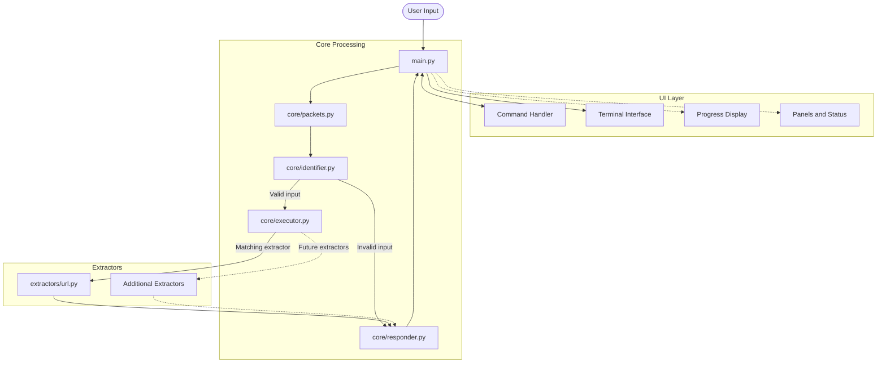

<div align="center">

<pre>
                                                  
                                                  
           ███                      ███           
         ████████                ████████         
        ██████████   ██    ██  ███████████        
       ███     ████████    ████████     ███       
       █▒█        ████      ████        █▒█       
       █▓█     ███ █          █ ███     █▓█       
       ███        █            █        ███       
       ███         ██        ██         ███       
        ███         ██      ██         ███        
           ██       ██      ██       ██           
                    ███    ███                    
                      █    █                      
                      █    █                      
                                                  
                       █  █                       
                                                  
                                                  
</pre>

</div>

<div align="center">


</div>

# Theseus

**Digital Artefact Extraction Tool**

Theseus is a modular command-line tool for identifying and extracting structured information from digital artefacts.

It accepts artefacts as input, identifies their type, and dispatches them to specialised extractors. Each extractor returns its results in a standardised data structure, preserving the information's provenance and any explicitly identified entities or related entities.

The artefact is the starting point. The entities it reveals are the leads.

## Features

- **Artefact identification** — Validates input and identifies the corresponding artefact type.
- **Modular extraction** — Uses specialised extractors for different digital artefacts.
- **Structured output** — Returns extraction results through a consistent Packet format.
- **Entity extraction** — Records entities explicitly identified within source artefacts.
- **Provenance tracking** — Preserves the origin and context of extracted information.
- **Extensible architecture** — Allows individual extractors to be developed and maintained independently.
- **Terminal interface** — Provides an interactive command-line environment with status reporting and formatted results.

## Architecture

Theseus follows a sequential processing architecture. Each stage has a defined responsibility and communicates through a shared Packet structure.



### Processing pipeline

| Component | Responsibility |
|---|---|
| `main.py` | Receives input, coordinates processing, and presents results. |
| `core/packets.py` | Defines the shared Packet structure used throughout the pipeline. |
| `core/identifier.py` | Validates input and identifies the requested artefact type. |
| `core/executor.py` | Dispatches the identified input to its corresponding extractor. |
| `extractors/` | Contains specialised modules responsible for extracting artefact data. |
| `core/responder.py` | Formats extraction results for presentation. |
| `ui/` | Provides the terminal interface and presentation components. |

## Packet Structure

All processing stages communicate through a standardised Packet envelope.

This provides a consistent structure for requests, extraction results, and errors, regardless of the artefact being processed.

Each Packet contains the following fields:

| Field | Description |
|---|---|
| `request_id` | Identifies the original request. |
| `task_id` | Identifies the current processing task. |
| `parent_task_id` | Identifies the parent task, where applicable. |
| `stage` | Indicates the current processing stage. |
| `artefact_type` | Identifies the artefact being processed. |
| `input` | Contains the supplied input. |
| `source` | Records the source of the artefact. |
| `status` | Represents the processing state. |
| `data` | Stores extracted information. |
| `entities` | Stores entities explicitly identified in the artefact. |
| `related_entities` | Stores explicitly identified related information. |
| `provenance` | Records the origin and context of extracted data. |
| `errors` | Records errors and warnings encountered during processing. |
| `metadata` | Stores supplementary processing information. |

The Packet structure ensures that extractors can operate independently without introducing inconsistencies into the wider processing pipeline.

## Extractor Scope

Theseus is designed to support a broad range of digital artefacts, organised into specialised extraction categories.

| Category | Artefact types |
|---|---|
| Web and Browser | URLs, redirects, HTTP responses, webpages, JavaScript, CSS, HAR files |
| Network and Infrastructure | IP addresses, CIDR ranges, hostnames, ASNs, MAC addresses, BSSIDs, ports, certificates, TLS, PCAP files, network flows |
| Files and Documents | File metadata, hashes, PDFs, office documents, archives, binaries, fonts, shortcuts, directories |
| Media | Images, audio, video |
| Email and Communications | Email addresses, email headers, message IDs, contacts, calendars, VCF, ICS |
| Software and Development | Git repositories, commits, packages, SBOMs, containers, API specifications, CVEs |
| Structured Data | JSON, XML, CSV, SQLite |
| Operating Systems | Configuration files, environment variables, registry artefacts, logs, browser artefacts |

Each artefact type is handled by a dedicated extractor. This keeps extraction logic isolated and allows new capabilities to be introduced without restructuring the core pipeline.

### Example

```text
theseus > --url https://github.com
```

Example extraction output:

```text
Artefact    url
Status      SUCCESS

Results
  Url               https://github.com
  Scheme            https
  Hostname          github.com
  Domain            github.com
  Port              None
  Path              None
  Query Parameters  None
  Fragment          None
```

Output fields depend on the artefact and the information available for extraction.

## Design Principles

**Modularity**

Each extractor is responsible for one artefact type. Extraction logic remains independent of the terminal interface and other extractors.

**Consistency**

Every processing stage uses the shared Packet structure. Extractors return standardised results rather than defining their own output formats.

**Traceability**

Extracted information retains its provenance. Explicitly identified entities and related entities are recorded without inventing relationships or drawing unsupported conclusions.

**Separation of Concerns**

Identification, execution, extraction, response formatting, and terminal presentation are handled by separate components.

**Extensibility**

New extractors can be introduced independently, provided they follow the shared Packet contract.

## Project Structure

```text
theseus/
│
├── core/
│   ├── packets.py
│   ├── identifier.py
│   ├── executor.py
│   └── responder.py
│
├── extractors/
│   └── url.py
│
├── ui/
│   ├── assets/
│   ├── banner.py
│   ├── commands.py
│   ├── panels.py
│   ├── progress.py
│   ├── status.py
│   ├── terminal.py
│   └── theme.py
│
├── main.py
└── README.md
```

Additional extractor modules are organised within the `extractors/` directory.

## Development

Theseus is designed around a simple extension model:

1. Implement the extraction logic for an artefact type.
2. Return the results using the shared Packet structure.
3. Register the extractor with the executor.
4. Add the corresponding input validation and command information.

The core processing pipeline and response format remain unchanged.

---

**Theseus v1.0.0**

Digital Artefact Extraction Tool

---
## Contributing

Contributions, bug reports, and suggestions are welcome. When reporting a problem, include the operating system, Python version, installation method, relevant command output, and steps needed to reproduce it. Never include private credentials or sensitive investigation data.

## Documentation

- **[Wiki](https://github.com/Proxy-Phaethon/theseus/wiki):** Detailed project documentation, technical references, and investigation-specific information.
- **[Releases](https://github.com/Proxy-Phaethon/theseus/releases):** Version history, release notes, and changes between releases.

## License

Theseus is released under the Apache License 2.0. See [LICENSE](LICENSE) for details.

<div align="center"> <pre>
░▒▓████████▓▒░▒▓█▓▒░░▒▓█▓▒░▒▓████████▓▒░░▒▓███████▓▒░▒▓████████▓▒░▒▓█▓▒░░▒▓█▓▒░░▒▓███████▓▒░ 
   ░▒▓█▓▒░   ░▒▓█▓▒░░▒▓█▓▒░▒▓█▓▒░      ░▒▓█▓▒░      ░▒▓█▓▒░      ░▒▓█▓▒░░▒▓█▓▒░▒▓█▓▒░        
   ░▒▓█▓▒░   ░▒▓█▓▒░░▒▓█▓▒░▒▓█▓▒░      ░▒▓█▓▒░      ░▒▓█▓▒░      ░▒▓█▓▒░░▒▓█▓▒░▒▓█▓▒░        
   ░▒▓█▓▒░   ░▒▓████████▓▒░▒▓██████▓▒░  ░▒▓██████▓▒░░▒▓██████▓▒░ ░▒▓█▓▒░░▒▓█▓▒░░▒▓██████▓▒░  
   ░▒▓█▓▒░   ░▒▓█▓▒░░▒▓█▓▒░▒▓█▓▒░             ░▒▓█▓▒░▒▓█▓▒░      ░▒▓█▓▒░░▒▓█▓▒░      ░▒▓█▓▒░ 
   ░▒▓█▓▒░   ░▒▓█▓▒░░▒▓█▓▒░▒▓█▓▒░             ░▒▓█▓▒░▒▓█▓▒░      ░▒▓█▓▒░░▒▓█▓▒░      ░▒▓█▓▒░ 
   ░▒▓█▓▒░   ░▒▓█▓▒░░▒▓█▓▒░▒▓████████▓▒░▒▓███████▓▒░░▒▓████████▓▒░░▒▓██████▓▒░░▒▓███████▓▒░  
</pre>