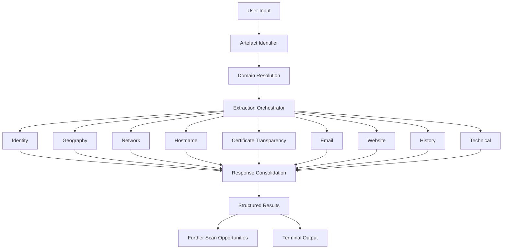

<div align="center">

<pre>
                                                  
                                                  
           ███                      ███           
         ████████                ████████         
        ██████████   ██    ██  ███████████        
       ███     ████████    ████████     ███       
       █▒█        ████      ████        █▒█       
       █▓█     ███ █          █ ███     █▓█       
       ███        █            █        ███       
       ███         ██        ██         ███       
        ███         ██      ██         ███        
           ██       ██      ██       ██           
                    ███    ███                    
                      █    █                      
                      █    █                      
                                                  
                       █  █                       
                                                  
                                                  
</pre>

</div>

<div align="center">


</div>

# Theseus

**A Digital Artefact Extraction and Discovery Tool**

Theseus is a modular digital artefact extraction tool designed to identify, retrieve, and organise useful information from digital artefacts.

Starting with a single input, Theseus identifies the underlying artefact, executes specialised extraction modules, and returns structured information gathered from multiple sources. Extracted information can also reveal additional artefacts that serve as starting points for further scans.

A domain, for example, can reveal associated IP addresses, hostnames, email infrastructure, geographical information, certificate records, historical data, and other technical details. These findings can then provide new inputs for further extraction using Theseus.

**The artefact is the starting point. Every extracted artefact is another lead.**

---

## Features

- **Artefact Identification:** Accepts digital inputs and identifies the artefact type and relevant extraction target.
- **Modular Extraction:** Uses specialised modules to retrieve information from different sources.
- **Structured Results:** Returns extracted information in a consistent, structured format.
- **Source Provenance:** Records where information originated and when it was retrieved.
- **Related Entity Discovery:** Identifies explicitly observed entities associated with the original artefact.
- **Further Scan Opportunities:** Highlights extracted artefacts that can be supplied as inputs for additional Theseus scans.
- **Terminal Interface:** Provides an interactive command-line environment for running extractions and viewing results.

## Current Artefact Support

### Domain Extraction

The current implementation focuses on domain-based extraction.

Theseus can accept:
- Registered domains
- Subdomains
- Full URLs

Inputs are identified and normalised to determine the relevant domain before extraction begins.

The domain extraction process uses nine specialised modules to retrieve information across several categories.

| Module | Extracted information |
|---|---|
| Identity | Domain registration and registrant information |
| Geography | Published geographical information and associated IP addresses |
| Network | IP addresses, DNS records, network allocations and autonomous systems |
| Hostname | Subdomains, nameservers, mail servers, redirects and associated domains |
| Certificate Transparency | Certificate records, observed hostnames and certificate associations |
| Email | Email addresses, mail infrastructure and email authentication records |
| Website | Website metadata, published identities, technologies and external resources |
| History | Historical records, archived URLs and certificate observations |
| Technical | DNS fingerprints, TLS information, public resources and common service availability |

Each module operates independently and returns its findings through a shared response structure.

## Extraction Workflow



## Further Scan Opportunities

One of Theseus's central capabilities is identifying additional artefacts that can be used to initiate further extractions.

For example, a domain extraction may return:

- IP addresses
- Email addresses
- Subdomains
- Hostnames
- Related domains
- Other identifiable digital artefacts

These values are not merely supplementary information. Where supported by the identifier and extraction system, they can become inputs for subsequent scans.

This creates an expandable extraction workflow in which each artefact can reveal additional starting points without requiring Theseus to infer relationships or perform investigative analysis.

## Response Structure

Every extraction module returns a standardised response envelope.

| Field | Description |
|---|---|
| `module` | Identifies the module responsible for the extraction |
| `status` | Indicates the extraction outcome |
| `data` | Contains the extracted information |
| `provenance` | Records the sources and retrieval methods |
| `related_entities` | Contains explicitly observed associated entities |
| `errors` | Records errors encountered during extraction |

Module statuses include:

- `success`
- `partial`
- `no_results`
- `error`

Maintaining a shared response structure allows modules to operate independently while keeping their outputs consistent and manageable.

## Architecture

Theseus follows a modular architecture that separates input identification, extraction, response handling, and terminal presentation.

| Component | Responsibility |
|---|---|
| `main.py` | Application entry point |
| `core/identifier.py` | Identifies and validates incoming artefacts |
| `core/domain.py` | Coordinates domain extraction |
| `core/responder.py` | Consolidates and normalises module responses |
| `domain/` | Contains the specialised domain extraction modules |
| `ui/` | Provides the terminal interface and output presentation |

Each extraction module is responsible for retrieving its own information, recording its provenance, and identifying explicitly observed related entities.

The shared architecture allows individual modules to be developed and maintained independently without requiring changes to the overall response contract.

## Installation

Clone the repository:

```bash
git clone <repository-url>
cd Theseus
```

Install the project dependencies:

```bash
pip install -r requirements.txt
```

Start Theseus:

```bash
python main.py
```

## Usage

Launch Theseus and enter a domain, subdomain, or URL when prompted.

```text
> example.com
```

Theseus identifies the relevant domain and initiates the available extraction modules.

The resulting information is presented in the terminal, organised by module and accompanied by extraction status and source information.

Use `help` within the application to view available commands.

## Project Status

**Version:** 1.0.0

Theseus v1.0.0 establishes the domain extraction framework, its modular architecture, and its shared response structure.

The project is designed to accommodate additional artefact types and specialised extraction modules as development progresses.

## Disclaimer

Theseus is intended for educational, research, and authorised information-gathering purposes.

Users are responsible for ensuring that their use of the tool and the information it retrieves complies with applicable laws, regulations, and third-party service policies.

Information returned by external sources may be incomplete, outdated, or inaccurate. Extracted results should be interpreted in the context of their recorded provenance.

## Contributing

Contributions, bug reports, and suggestions are welcome. When reporting a problem, include the operating system, Python version, installation method, relevant command output, and steps needed to reproduce it. Never include private credentials or sensitive investigation data.

## Documentation

- **[Wiki](https://github.com/Proxy-Phaethon/theseus/wiki):** Detailed project documentation, technical references, and investigation-specific information.
- **[Releases](https://github.com/Proxy-Phaethon/theseus/releases):** Version history, release notes, and changes between releases.

## License

Theseus is released under the Apache License 2.0. See [LICENSE](LICENSE) for details.

<div align="center"> <pre>
░▒▓████████▓▒░▒▓█▓▒░░▒▓█▓▒░▒▓████████▓▒░░▒▓███████▓▒░▒▓████████▓▒░▒▓█▓▒░░▒▓█▓▒░░▒▓███████▓▒░ 
   ░▒▓█▓▒░   ░▒▓█▓▒░░▒▓█▓▒░▒▓█▓▒░      ░▒▓█▓▒░      ░▒▓█▓▒░      ░▒▓█▓▒░░▒▓█▓▒░▒▓█▓▒░        
   ░▒▓█▓▒░   ░▒▓█▓▒░░▒▓█▓▒░▒▓█▓▒░      ░▒▓█▓▒░      ░▒▓█▓▒░      ░▒▓█▓▒░░▒▓█▓▒░▒▓█▓▒░        
   ░▒▓█▓▒░   ░▒▓████████▓▒░▒▓██████▓▒░  ░▒▓██████▓▒░░▒▓██████▓▒░ ░▒▓█▓▒░░▒▓█▓▒░░▒▓██████▓▒░  
   ░▒▓█▓▒░   ░▒▓█▓▒░░▒▓█▓▒░▒▓█▓▒░             ░▒▓█▓▒░▒▓█▓▒░      ░▒▓█▓▒░░▒▓█▓▒░      ░▒▓█▓▒░ 
   ░▒▓█▓▒░   ░▒▓█▓▒░░▒▓█▓▒░▒▓█▓▒░             ░▒▓█▓▒░▒▓█▓▒░      ░▒▓█▓▒░░▒▓█▓▒░      ░▒▓█▓▒░ 
   ░▒▓█▓▒░   ░▒▓█▓▒░░▒▓█▓▒░▒▓████████▓▒░▒▓███████▓▒░░▒▓████████▓▒░░▒▓██████▓▒░░▒▓███████▓▒░  
</pre>